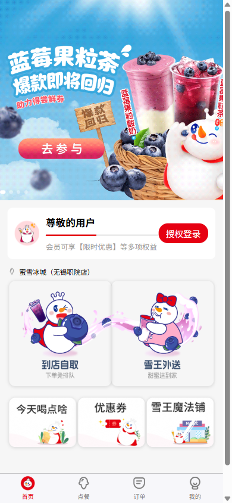
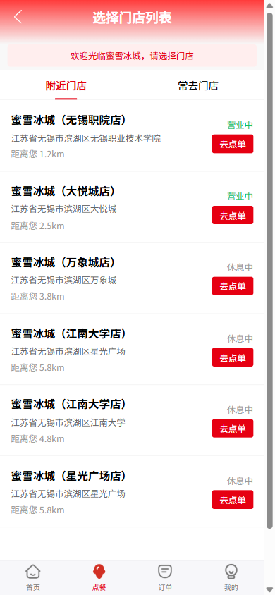
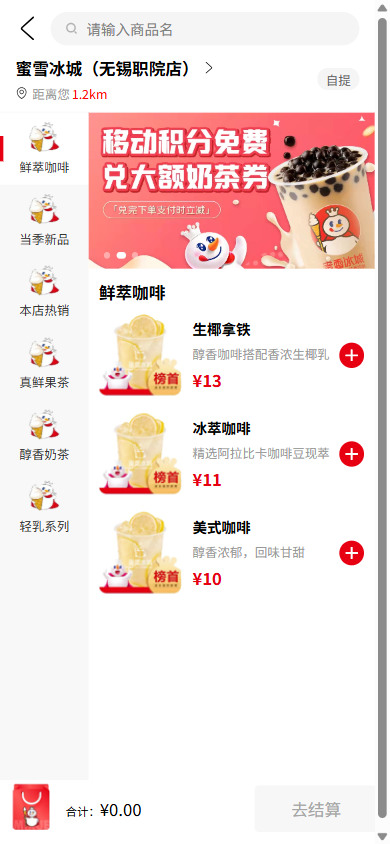
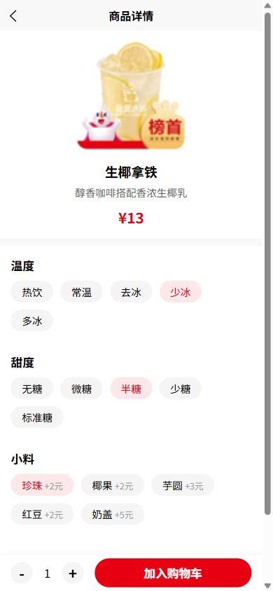
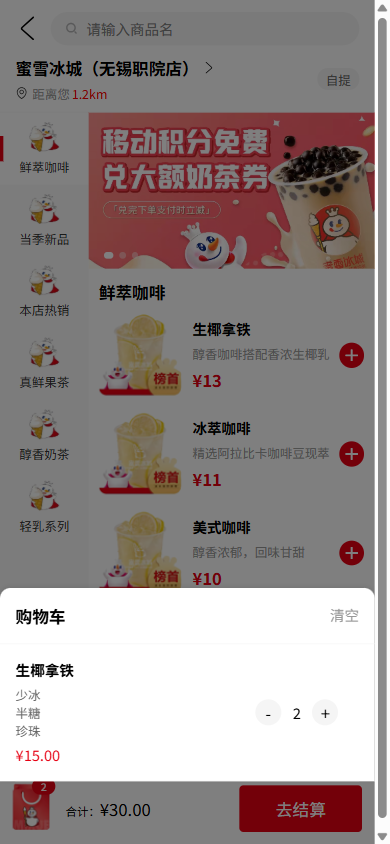
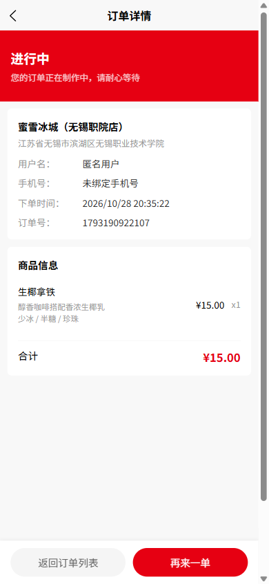
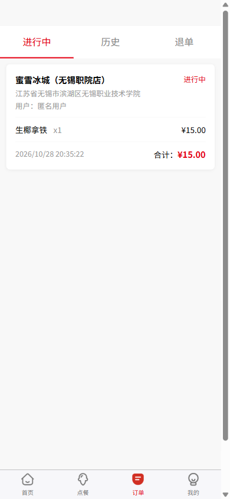
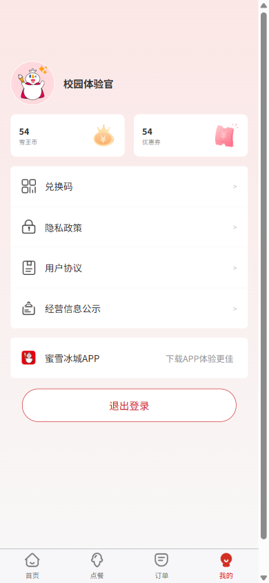
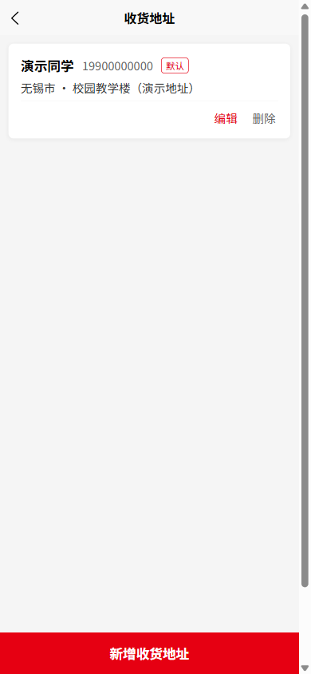

<div align="center">

# SnowKing Campus 2025

**雪王校园点单 · 仿蜜雪冰城小程序课程设计**

Vue 3 + uni-app 实现的移动端点单前端，记录一份完成于 2025 年春季的大二课设。


[页面预览](#页面预览) · [功能说明](#功能说明) · [快速开始](#快速开始) · [课程报告](#课程报告)

</div>

## 项目简介

这份项目来自《前端框架专用周》课程设计，原题目为“蜜雪冰城点单系统”，开发时间为 **2025 年 4 月 21 日至 4 月 30 日**。项目以当时使用的蜜雪冰城小程序界面为参照，练习移动端布局、组件封装、页面通信和本地数据持久化。

从首页选择到店自取或雪王外送，进入门店、浏览分类、选择饮品规格，再生成并查看订单，是本项目的主要演示路径。源码、重新运行后的截图和脱敏课程报告一并公开，方便学习和复现。

名称中的 `Campus` 表示校园课设背景，`2025` 标明复刻时期，便于与其他同题材项目区分。本项目保留的是 **2025 年春季的界面实践**，并不跟随官方小程序持续更新。

与较早的 Vue 2 + Vue CLI 实现相比，本项目使用 Vue 3 + Vite，并采用会员卡片、自取 / 外送双入口的首页布局。多个同题材仓库的具体差异与核对依据见 [项目对照](docs/project-comparison.md)。

> 本项目是非官方的纯前端学习作品。门店、商品和会员权益使用演示数据；结算仅生成本地订单，没有接入真实支付、配送服务或后端数据库。

## 页面预览

以下为 **2026 年 10 月 28 日重新运行源码后截取的 H5 页面**，视口为 390 × 844。微信小程序构建已验证，截图不代表微信真机测试。

<table>
  <tr>
    <th>首页</th><th>选择门店</th><th>分类点餐</th>
  </tr>
  <tr>
    <td></td>
    <td></td>
    <td></td>
  </tr>
  <tr>
    <th>规格选择</th><th>购物车</th><th>订单详情</th>
  </tr>
  <tr>
    <td></td>
    <td></td>
    <td></td>
  </tr>
  <tr>
    <th>订单列表</th><th>个人中心</th><th>收货地址</th>
  </tr>
  <tr>
    <td></td>
    <td></td>
    <td></td>
  </tr>
</table>

更多截图及拍摄说明见 [截图目录](docs/screenshots/README.md)。

## 功能说明

| 模块 | 已实现的演示能力 | 数据与边界 |
| --- | --- | --- |
| 首页 | 活动轮播、登录状态、会员卡片、自取与外送入口 | 活动素材为本地文件，部分活动链接未实现 |
| 门店 | 门店列表、详情弹窗、门店选择、外送地址入口 | 地址、距离、营业状态为静态示例；“常去门店”未接入独立数据 |
| 菜单 | 6 类饮品、分类内关键词搜索、商品详情 | 商品名称和价格为演示数据，不代表官方在售菜单 |
| 商品规格 | 温度、甜度、小料、数量和金额计算 | 支持定制商品加入购物车 |
| 购物车 | 商品增减、清空、规格展示和总价联动 | 页面状态，不提供服务端购物车 |
| 订单 | 模拟结算、订单列表、详情、状态筛选、再来一单 | 订单保存在本地；制作、完成和退款状态不会由真实服务更新 |
| 地址 | 新增、编辑、删除、默认地址和地址选择 | 保存在当前设备本地 |
| 账号 | 本地注册、登录、表单校验、退出登录 | 手机号和密码在本地比对，非微信授权；仅使用虚构测试资料 |
| 个人中心 | 登录信息、雪王币和优惠券卡片 | 币、券数量为展示值；兑换、协议等入口尚未完整实现 |

## 技术栈

| 技术 | 版本 / 用途 |
| --- | --- |
| Vue | 3.4.21，单文件组件与响应式界面 |
| uni-app | `3.0.0-4050720250324001`，跨端页面和 API |
| Vite | 5.2.8，开发与生产构建 |
| uni-ui | 通用组件，如门店详情弹窗 |
| JavaScript / SCSS | 业务逻辑和移动端样式 |
| `uni.getStorageSync` / `uni.setStorageSync` | 账号、登录状态、地址、门店和订单的本地持久化 |

不需要安装数据库或启动后端。项目保留原来的源码目录名称，便于对照课程报告。

## 快速开始

### 1. 获取代码和安装依赖

原项目记录的 Node.js 版本为 **22.11.0**，源码目录提供了 `.nvmrc`。建议使用该版本复现，并使用 `npm ci` 按锁文件安装依赖。

```bash
git clone https://github.com/kkkioio/snowking-campus-2025.git
cd snowking-campus-2025
cd "蜜雪冰城小程序"
npm ci
```

### 2. 在浏览器中运行

```bash
npm run dev:h5
```

打开终端显示的本地地址，通常为 `http://localhost:5173`。在浏览器开发者工具中切换到手机视口，建议宽度 375～430 px。

### 3. 在微信开发者工具中运行

```bash
npm run dev:mp-weixin
```

1. 安装并打开微信开发者工具。
2. 导入 **`蜜雪冰城小程序/dist/dev/mp-weixin`**，不要直接导入仓库根目录。
3. 使用自己的测试 AppID；如需固定配置，在 `src/manifest.json` 的 `mp-weixin.appid` 中填写。仓库默认留空。
4. 保持终端运行，源码修改后会重新编译。

也可使用 HBuilderX 打开 `蜜雪冰城小程序` 目录，安装依赖后运行到微信开发者工具。平台定位、地图等能力需要对应的环境配置，本次仅确认编译成功。

### 4. 生产构建

```bash
npm run build:h5
npm run build:mp-weixin
```

输出分别位于 `dist/build/h5` 和 `dist/build/mp-weixin`。构建产物和 `node_modules` 不纳入版本管理。模板中的其他平台命令尚未逐一验证。

## 建议体验顺序

1. 首页选择“到店自取”，在门店列表点击“去点单”。
2. 切换饮品分类或输入关键词，点击商品进入详情。
3. 选择少冰、半糖、小料和数量，加入购物车，检查总价。
4. 点击“去结算”，生成模拟订单，查看详情和订单列表。
5. 在“我的”页面进入注册、登录，观察首页和个人中心的状态变化。
6. 回到首页选择“雪王外送”，进入配送地址列表，体验新增、编辑和删除。

账号、手机号、地址请使用虚构测试内容。注册模块将演示密码以明文保存到本地，不应使用真实密码。清理浏览器站点数据或微信开发者工具缓存，会清除当前设备的演示记录；数据不在设备之间同步，也未按账号隔离订单和地址。

## 目录结构

```text
snowking-campus-2025/
├── README.md
├── LICENSE
├── THIRD_PARTY_NOTICES.md        # 素材来源和许可范围
├── docs/
│   ├── screenshots/             # 实际运行截图
│   ├── report/                  # 脱敏课程报告 PDF
│   └── verification.md          # 本次构建、运行验证和整理改动
└── 蜜雪冰城小程序/
    ├── src/
    │   ├── components/          # 分类侧栏、购物车、轮播图、进度条
    │   ├── pages/
    │   │   ├── index/           # 首页
    │   │   ├── product/         # 商品详情
    │   │   └── list/            # 门店、菜单、订单、账号、地址、个人中心
    │   ├── static/              # 图片和图标
    │   ├── style/               # 主题样式
    │   ├── pages.json           # 页面路由与底部导航
    │   ├── manifest.json        # 平台配置
    │   ├── App.vue
    │   └── main.js
    ├── package.json
    ├── package-lock.json
    └── vite.config.js
```

## 课程报告

[阅读课程报告 PDF（公开脱敏版）](docs/report/course-report-2025-public.pdf)

报告保留当时的系统分析、功能设计、页面截图、实现代码和实训小结，报告署期为 **2025 年 4 月 30 日**。公开版本移除了学号、班级、教师姓名及文档作者元数据；原始 Word 和重复的程序压缩包保留在本地，不上传。

报告中的截图和部分技术表述属于历史提交内容。本次没有重写报告，最新运行效果请看上面的页面预览，当前功能以源码及本 README 的说明为准。

## 验证与后续改进

本次整理已通过 H5 和微信小程序生产构建，并在浏览器中检查主要交互。详细环境、验证结果和修复记录见 [验证说明](docs/verification.md)。

后续可以继续完善：

- 接入后端账号、商品、门店和订单接口，并实现账号数据隔离。
- 为收藏门店、优惠券、积分、活动页补齐业务逻辑。
- 统一购物车及跨页面数据结构，完善异常处理。
- 在具备正式配置后，补充微信真机、地图及定位测试。

## 许可与致谢

作者有权许可的源码和文档采用 [MIT License](LICENSE)。蜜雪冰城品牌名称、雪王形象、商品图、活动图及第三方素材不适用该许可，其权利归相应权利人所有。本项目与蜜雪冰城官方无关联。素材与依赖说明见 [THIRD_PARTY_NOTICES.md](THIRD_PARTY_NOTICES.md)。

感谢 [Vue](https://github.com/vuejs/core)、[uni-app](https://github.com/dcloudio/uni-app) 和 [uni-ui](https://github.com/dcloudio/uni-ui)。README 的信息组织参考了 [hello-uniapp](https://github.com/dcloudio/hello-uniapp) 与 [yudao-mall-uniapp](https://github.com/yudaocode/yudao-mall-uniapp) 等开源项目；上述链接用于说明参考对象，不表示存在官方合作关系。

如发现问题，欢迎通过 [Issues](https://github.com/kkkioio/snowking-campus-2025/issues) 提供复现步骤、运行平台和截图。
